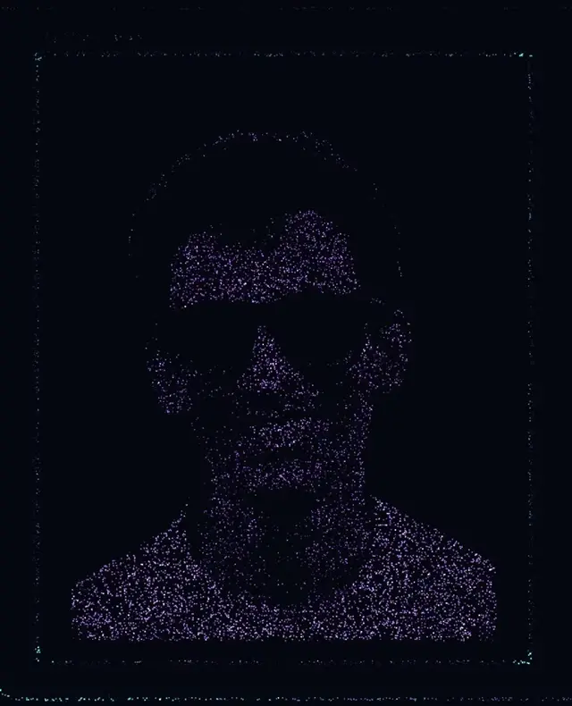
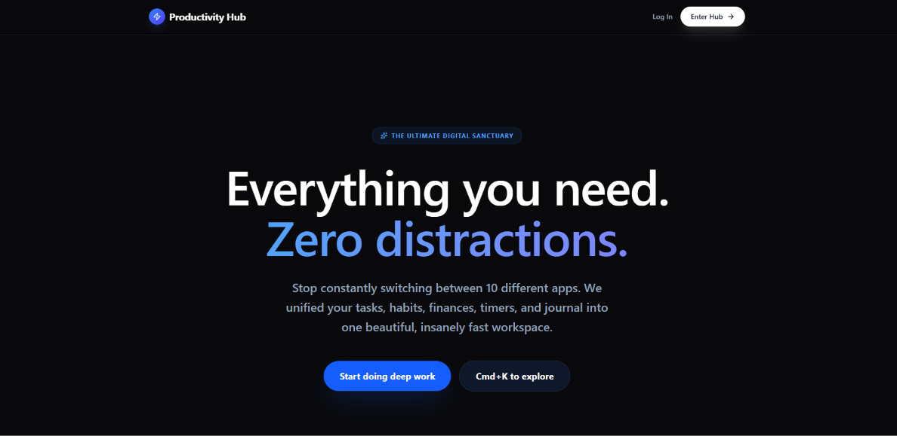
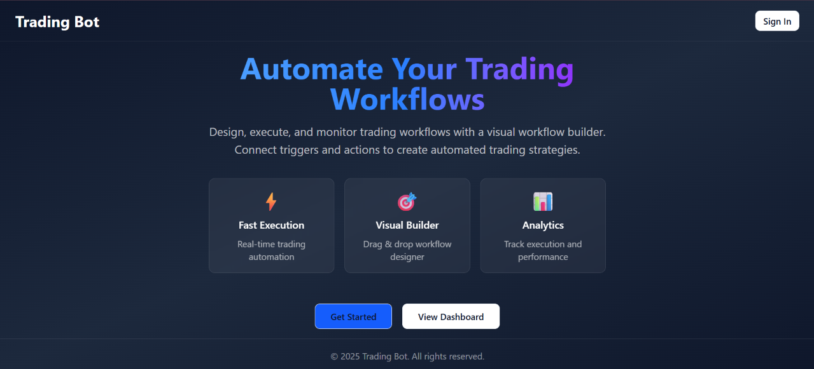
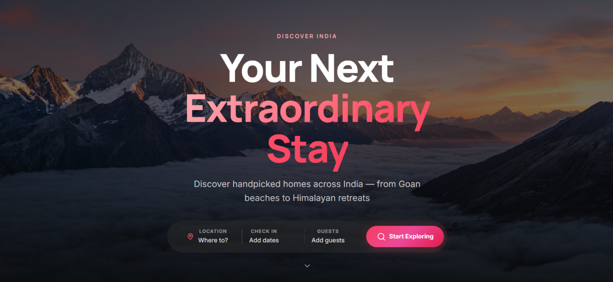

<a id="top"></a>

<div align="center">

<!-- Hero -->
<a href="https://visheshio.runs-on.dev/">
  
</a>

<a href="https://git.io/typing-svg">
  
</a>

<br/>

<a href="mailto:maheshwarivishesh17@gmail.com">
  
</a>
<a href="https://github.com/visheshio?tab=followers">
  
</a>

<a href="https://visheshio.runs-on.dev/">
  
</a>

<br/><br/>

<p>
  <i>Bridging backend horsepower with visual fidelity.</i><br/>
  <sub>TypeScript &nbsp;•&nbsp; React / Next.js &nbsp;•&nbsp; Node.js &nbsp;•&nbsp; PostgreSQL &nbsp;•&nbsp; WebGL</sub>
</p>

<b>
  <a href="#about">About</a> &nbsp;•&nbsp;
  <a href="#stack">Tech Stack</a> &nbsp;•&nbsp;
  <a href="#projects">Projects</a> &nbsp;•&nbsp;
  <a href="#activity">Activity</a> &nbsp;•&nbsp;
  <a href="#contact">Contact</a>
</b>

</div>

<br/>

<br/>

<!-- ───────────────────────────── ABOUT ───────────────────────────── -->

<a id="about"></a>
<h2 align="center">👨‍💻 About</h2>
<p align="center"><sub>Who I am, what I use, and what I'm building next.</sub></p>

<table width="100%">
<tr>
<td width="55%" valign="top">

```typescript
/**
 * @file   vishesh.config.ts
 * @status Focused & shipping 🚀
 */

export const vishesh = {
  handle:    "visheshio",
  location:  "Surat, Gujarat, IN 🇮🇳",
  languages: ["TypeScript", "JavaScript", "Python"],
  frontend:  ["Next.js", "React", "Vue", "Tailwind"],
  backend:   ["Node.js", "Express", "REST", "GraphQL"],
  databases: ["PostgreSQL", "Supabase", "MongoDB"],
  devops:    ["Vercel", "GitHub Actions", "Docker"],
  currently: "Real-time 3D (WebGL) & AI-driven UIs 🌌",
  openTo:    ["Collaborations", "Open source", "Engineering roles"],
  motto:     "First solve architecture, then write code.",
} as const;
```

</td>
<td width="45%" align="center" valign="middle">
  <a href="https://visheshio.runs-on.dev/" target="_blank">
    
  </a>
  <br/>
  <sub><b>🌌 VISUAL.MAP</b> — generative particle canvas</sub>
</td>
</tr>
</table>

<p align="center">
  I build full-stack products end to end — from API design and data modeling to fast, polished interfaces —<br/>
  and I'm currently exploring real-time 3D with WebGL and AI-driven UIs.
</p>

<br/>

<br/>

<!-- ───────────────────────────── STACK ───────────────────────────── -->

<a id="stack"></a>
<h2 align="center">🛠️ Tech Stack</h2>
<p align="center"><sub>Tools chosen for velocity, performance, and production reliability.</sub></p>

<table width="100%">
  <tr>
    <td width="24%"><b>⚡ Languages</b></td>
    <td></td>
  </tr>
  <tr>
    <td><b>🎨 Frontend & UI</b></td>
    <td></td>
  </tr>
  <tr>
    <td><b>⚙️ Backend & APIs</b></td>
    <td></td>
  </tr>
  <tr>
    <td><b>🗄️ Databases</b></td>
    <td></td>
  </tr>
  <tr>
    <td><b>🚀 DevOps & CI/CD</b></td>
    <td></td>
  </tr>
  <tr>
    <td><b>🧰 Tooling</b></td>
    <td></td>
  </tr>
  <tr>
    <td><b>🌌 Exploring</b></td>
    <td></td>
  </tr>
</table>

<br/>

<br/>

<!-- ──────────────────────────── PROJECTS ─────────────────────────── -->

<a id="projects"></a>
<h2 align="center">🚀 Featured Projects</h2>
<p align="center"><sub>Production-minded apps with live demos and open source code.</sub></p>

<table>
  <!-- Productivity Hub -->
  <tr>
    <td width="44%" valign="middle" align="center">
      <a href="https://build-productivity-hub.vercel.app/" target="_blank">
        
      </a>
    </td>
    <td width="56%" valign="top">
      <h3>🧠 Productivity Hub</h3>
      
      <p>
        An all-in-one workspace built for focused work: task management, distraction-free timers,
        real-time state sync, and keyboard-first shortcuts.
      </p>
      <p>
        
        
        
        
      </p>
      <p>
        <a href="https://build-productivity-hub.vercel.app/"></a>
        <a href="https://github.com/visheshio/build-productivity-hub"></a>
      </p>
    </td>
  </tr>

  <!-- Trading Automation -->
  <tr>
    <td width="44%" valign="middle" align="center">
      <a href="https://trading-n8n-monorepo.vercel.app/" target="_blank">
        
      </a>
    </td>
    <td width="56%" valign="top">
      <h3>⚡ Visual Trading Automation Engine</h3>
      
      <p>
        A node-based visual canvas for assembling, backtesting, and dispatching automated trading
        pipelines, integrated with n8n and structured as a TypeScript monorepo.
      </p>
      <p>
        
        
        
        
      </p>
      <p>
        <a href="https://trading-n8n-monorepo.vercel.app/"></a>
        <a href="https://github.com/visheshio/trading-bot"></a>
      </p>
    </td>
  </tr>

  <!-- Stays Marketplace -->
  <tr>
    <td width="44%" valign="middle" align="center">
      <a href="https://advanced-airbnb-clone.vercel.app/" target="_blank">
        
      </a>
    </td>
    <td width="56%" valign="top">
      <h3>🏡 Stays Marketplace</h3>
      
      <p>
        A full-featured accommodation booking platform with map-based browsing and clustering,
        faceted search filters, a streamlined reservation flow, and a relational PostgreSQL data model.
      </p>
      <p>
        
        
        
        
      </p>
      <p>
        <a href="https://advanced-airbnb-clone.vercel.app/"></a>
        <a href="https://github.com/visheshio/advanced-airbnb-clone"></a>
      </p>
    </td>
  </tr>
</table>

<p align="center">
  <a href="https://github.com/visheshio/Spotifyclone"></a>
  <a href="https://github.com/visheshio?tab=repositories"></a>
</p>

<br/>

<br/>

<!-- ───────────────────────────── ACTIVITY ─────────────────────────── -->

<a id="activity"></a>
<h2 align="center">📊 GitHub Activity</h2>
<p align="center"><sub>Live stats pulled from the GitHub API.</sub></p>

<p align="center">
  <a href="https://github.com/visheshio">
    
  </a>
  <a href="https://github.com/visheshio">
    
  </a>
</p>

<p align="center">
  <a href="https://github.com/visheshio">
    
  </a>
</p>

<p align="center">
  <a href="https://github.com/visheshio">
    
  </a>
</p>

<h3 align="center">🐍 Contribution Snake</h3>
<p align="center">
  <picture>
    <source media="(prefers-color-scheme: dark)" srcset="https://raw.githubusercontent.com/visheshio/visheshio/output/github-contribution-grid-snake-dark.svg" />
    <source media="(prefers-color-scheme: light)" srcset="https://raw.githubusercontent.com/visheshio/visheshio/output/github-contribution-grid-snake.svg" />
    
  </picture>
</p>

<h3 align="center">🏆 Trophies</h3>
<p align="center">
  <a href="https://github.com/visheshio">
    
  </a>
</p>

<br/>

<br/>

<!-- ───────────────────────────── CONTACT ──────────────────────────── -->

<a id="contact"></a>
<h2 align="center">🤝 Let's Connect</h2>
<p align="center">
  Have a product idea, an open source collaboration in mind, or an engineering role to fill? <b>Let's talk.</b>
</p>

<p align="center">
  <a href="https://visheshio.runs-on.dev/"></a>
  <a href="https://linkedin.com/in/visheshio"></a>
  <a href="https://twitter.com/Visheshio"></a>
  <a href="mailto:maheshwarivishesh17@gmail.com"></a>
  <a href="https://dev.to/visheshio"></a>
  <a href="https://discord.com/users/visheshio"></a>
</p>

<div align="center">
  <table>
    <tr>
      <td align="center">
        <b>☕ Support my open source work</b><br/>
        <sub>If my repos or code samples helped you, consider sponsoring.</sub>
        <br/><br/>
        <a href="https://github.com/sponsors/visheshio">
          
        </a>
      </td>
    </tr>
  </table>
</div>

<br/>

<!-- ───────────────────────────── FOOTER ───────────────────────────── -->

<a href="https://visheshio.runs-on.dev/">
  
</a>

<div align="center">
  <br/>
  <sub>💡 <i>"First, solve the problem. Then, write the code."</i> — John Johnson</sub>
  <br/><br/>
  <a href="#top"><sub><b>↑ Back to top</b></sub></a>
  <br/><br/>
  
</div>
